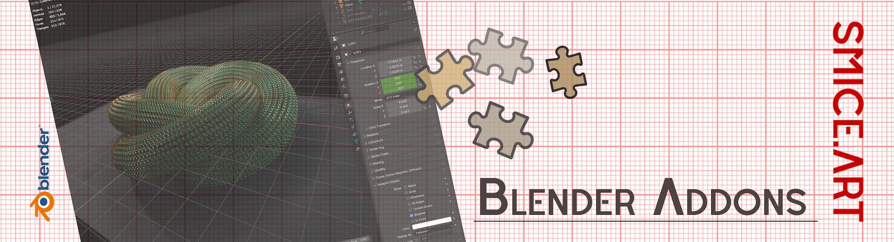
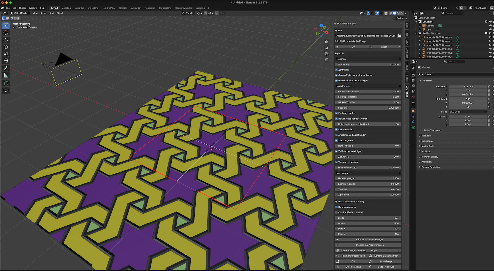

  

# SVG Pattern Import – User Guide

SVG Pattern Import brings geometric patterns from SVG files (for example converted from PDF) into Blender as clean curves, cuts out seamless tiles and saves them for the **Tile Lab** add-on.

The panel lives in the 3D Viewport under **N-Panel › SVG Pattern**.

> **Note 1:** The panel is currently in German, written without umlauts (e.g. "Groesse"). This guide quotes every label exactly as it appears in the panel and explains it in English.

> **Note 2:** The Tool is developed for Blender ADDON "Tile Lab" available on Superhivemarket https://superhivemarket.com/products/blender-tile-lab.

---

## Contents

- [Overview](#overview)
- [Source: loading patterns](#source-loading-patterns)
- [Result: basic settings](#result-basic-settings)
- [Clipping at the page edge](#clipping-at-the-page-edge)
- [Safety, overlaps and fine-tuning](#safety-overlaps-and-fine-tuning)
- [Square crop (tile)](#square-crop-tile)
- [Cutting and saving to Tile Lab](#cutting-and-saving-to-tile-lab)
- [More features and limits](#more-features-and-limits)

---

## Overview

Typical workflow for a Tile Lab tile:

1. Choose a folder of SVGs, then browse the patterns with **Laden** (Load) or the arrow buttons.
2. Press **Groesse aus Muster messen** (Measure size from pattern). The frame's width and height are then set exactly to the pattern's repeat.
3. Move the frame to the most attractive spot (mouse, arrow keys or sliders).
4. Turn on **Wiederholungs-Vorschau** (Repeat preview) and check the seams while zoomed in.
5. Press **Cut -> Tile Lab**. The tile appears in Tile Lab under "Custom".

If the SVG page itself is already exactly one repeat, skip steps 2–4: **Seite -> Tile Lab** (Page → Tile Lab) saves the whole page.

---

## Source: loading patterns

The **Quelle** (Source) box selects the folder and browses its SVG files. Every load goes into the preview collection *SVGPat_Vorschau*, which is replaced each time.

| Element | Function |
| --- | --- |
| Ordner (Folder) | Folder containing the SVG files. Below it: current number, total count and file name. |
| ◀ / ▶ | Load the previous / next file. |
| Number field | Jump straight to a file (then press **Laden**). |
| Laden (Load) | Reloads the selected file with the current settings. |

---

## Result: basic settings

The **Ergebnis** (Result) box controls how the SVG is turned into curves. The defaults suit most patterns; changes take effect on the next **Laden**.

| Element | Default | Function |
| --- | --- | --- |
| Modus (Mode) | Flaechen | **Flaechen** (Areas): filled shapes, fill and stroke duplicates merged. **Linien-Netz** (Line network): outlines only, shared edges once, chained into long strands. **Beides** (Both): both as separate objects. |
| Skalierung (Scale) | 0.01 | Metres per SVG unit. 0.01 turns a 612-unit page into 6.12 m. |
| Zentrieren (Center) | on | Places the centre of the pattern (or of the crop rectangle) at the world origin. |
| Gerade Zwischenpunkte entfernen | on | Removes points lying on a straight edge – fewer points, same shape. |
| Haarlinien-Spitzen bereinigen | on | Removes paths that run back and forth along the same line. Otherwise Blender fills such shapes incorrectly. |
| Gruppierung (Grouping) | Nach Formtyp | **Nach Formtyp** (By shape type): one object per shape type (all rhombi, all stars …), regardless of rotation and mirroring. **Nach Farbe** (By colour): one object per fill colour. **Alles in einem** (All in one): a single curve object. **Automatisch (exakt)**: no gap, touching shapes spread over a few objects. |
| Punkte verschweissen (Weld points) | 0.4 | Corner points closer than this (SVG units) get the same coordinate. Compensates PDF rounding errors. 0 = off. |
| Formtyp-Toleranz (Shape tolerance) | 0.15 | Length tolerance when recognising identical shapes (SVG units). |
| Winkel-Toleranz (Angle tolerance) | 1.5° | Angle tolerance when recognising identical shapes. |
| Spalt (m) (Gap) | 0.00003 | Invisible gap between shapes (0.03 mm). Without it Blender merges shared corners and fills incorrectly. |
| Fuellung pruefen (Check fill) | on | Compares the filled area with the computed one and splits objects when Blender fills wrongly. |
| Beruehrende Formen trennen | on | Distributes touching or overlapping shapes across several curve objects so Blender doesn't punch holes. |
| Linien weiterfuehren bis (Grad) | 60 | Line network only: at crossings, lines continue as long as the bend is at most this angle. 0 = split at every crossing. |
| Teilflaechen vereinigen | on | Paths made of several triangles or parts (shading in the PDF) are cleanly merged or separated. |

---

## Clipping at the page edge

Just like Affinity or a PDF viewer, everything outside the SVG page is cut off exactly; the edges can be moved inwards or outwards. With **Live-Vorschau** (Live preview) every change shows immediately, without reloading.

| Element | Default | Function |
| --- | --- | --- |
| Live-Vorschau (Live preview) | on | Page-clip changes are applied to the loaded file instantly. Switches itself off if a load takes longer than 2 s. |
| Am Seitenrand abschneiden (Clip at page edge) | on | Shapes outside the page (viewBox) are removed, partly visible shapes are trimmed exactly. Off = import everything. |
| X und Y gleich (X and Y equal) | on | One shared value for all four sides. Off = four separate values. |
| Rand-Abstand (Margin) | 0 | Shared value: moves the cut edge inwards (+) or outwards (−), in SVG units. |
| Links / Rechts / Oben / Unten | 0 | Like Margin, but per side – left / right / top / bottom (only shown when "X und Y gleich" is off). |

**Tip:** With "Zentrieren" on, the centre of the clip rectangle always sits at the origin. Moving an edge moves the origin with it.

---

## Safety, overlaps and fine-tuning

These values are also in the **Ergebnis** box. They protect Blender with very large patterns and control how overlapping shapes behave; normally leave them at their defaults.

| Element | Default | Function |
| --- | --- | --- |
| Zeitlimit (s) (Time limit) | 20 | Aborts an import that takes longer instead of letting Blender hang. 0 = off. |
| Viewport schuetzen (Protect viewport) | on | Switches the viewport to Solid when an object has a very large number of curves (from 4000). Otherwise Blender can freeze for minutes while drawing. |
| Hoehenstaffel (m) (Height stacking) | 0.0003 | Lifts each fill colour slightly in paint order, lines on top. Prevents flickering (z-fighting) where shapes overlap. 0 = off. |
| Echte Ueberlappung (True overlap) | Nur Kanten | **Nur Kanten** (Edges only): shapes that genuinely overlap get no fill; their outlines go into a separate line object. **Auf Ebenen** (On layers): overlapping shapes are stacked in paint order. |
| Ueberlappung ab (Overlap from) | 0.05 | Fraction of the smaller shape from which an overlap counts as real. Below that it's a PDF rounding artefact. |
| Ebenen-Abstand (Layer spacing) | 0.002 m | Z spacing between layers for "Auf Ebenen". |
| Toleranz (Tolerance) | 0.01 | Points closer than this are treated as identical (SVG units). Important for detecting duplicates. |
| Z pro Form (Z per shape) | 0 | Additional height offset per shape in order, e.g. for exploded or relief effects. |

---

## Square crop (tile)

A red frame in the viewport marks the area that becomes a seamless tile. The tile is seamless when width and height match the pattern's repeat exactly – its position is then free. All sizes are in SVG units; Y counts downwards as in SVG.

| Element | Function |
| --- | --- |
| Rahmen anzeigen (Show frame) | Shows or hides the red frame with its centre cross. |
| Quadrat (Breite = Hoehe) (Square) | Keeps width and height equal. Off = set both separately, for patterns that aren't 1:1. |
| Breite / Hoehe (Width / Height) | Size of the frame (3 decimals). |
| Mitte X / Mitte Y (Centre X / Y) | Position of the frame. |
| Rahmen mit Maus bewegen (Move frame with mouse) | Starts mouse and keyboard control (see below). |
| Groesse aus Muster messen (Measure size from pattern) | Finds the smallest horizontal and vertical shift that maps the pattern onto itself (same shape, colour and position) and sets width and height to it. If the frame extends beyond the page, it is pushed back onto the page. If nothing is found, the pattern doesn't fully repeat on the page – set the size by hand. |
| Wiederholungs-Vorschau (Repeat preview) | Repeats the crop live in every direction around the frame, the way Tile Lab will tile it later. The original is hidden meanwhile. Rebuilds shortly after every move or resize. |
| Ringe (Rings) | Number of tile rings in the preview: 1 = 3×3, 2 = 5×5, 3 = 7×7. |
| Kachelgrenzen (Tile borders) | Opacity of thin red lines at the seams (0 = off), so you know where to zoom in. |
| Vorschau aktualisieren (Refresh preview) | Only appears for very large patterns (build over 2 s): the preview then no longer follows automatically and is refreshed with this button. |
| Rahmen zuruecksetzen (Reset frame) | Frame back to the page centre at half the page size. |
| Kamera 1:1 auf Rahmen (Camera 1:1 on frame) | Places an orthographic camera *SVGPat_Kamera* straight above the frame and sets the render resolution to its aspect ratio (longer side at least 1024 px). |

Controls after **Rahmen mit Maus bewegen** (hints are also shown in the viewport header):

| Input | Effect |
| --- | --- |
| Left mouse drag | Move frame |
| Mouse wheel | Larger / smaller; with Alt only the width |
| Arrow keys | Move by 1 unit |
| Alt + arrow keys | Left/right: width, up/down: height |
| + / − | Width and height together |
| Add Shift / Ctrl | Fine (0.1) / coarse (10) |
| Enter or Space | Confirm |
| Esc or right mouse button | Cancel, previous frame restored |

---

## Cutting and saving to Tile Lab

All four buttons cut exactly like "Am Seitenrand abschneiden" and put the result, centred on the origin, into the collection *‹filename›_Kachel*. A new cut only replaces curves created by the add-on; your own objects in that collection (e.g. converted meshes) are kept.

| Button | Result |
| --- | --- |
| Cut | Separate curve objects, grouped as when loading. |
| Cut & Merge | A single curve object *‹name›_Kachel_Kurve*; every colour is kept as a material slot. Ideal for Array modifiers. Outline curves, if any, go into a second object *…_Linien*. |
| Cut -> Tile Lab | Like Cut & Merge, and additionally saves the tile as *‹name›_kachel.tilelab.json* into Tile Lab's Custom folder. Tile Lab reloads its Custom list automatically. Existing files are never overwritten but numbered (_2, _3 …). |
| Seite -> Tile Lab (Page → Tile Lab) | Like Cut -> Tile Lab, but without the frame: the whole page (with the margins set above). For SVGs that are already exactly one repeat. |

The Tile Lab file is built straight from the SVG, exactly as the pattern is painted in the PDF: later shapes cover earlier ones, independent of Blender's overlap mode. These options apply:

| Element | Default | Function |
| --- | --- | --- |
| Naehte schliessen (Close seams) | on | Merges pieces of the same colour into one area, closes hairline gaps and cuts exactly to the tile. Without it, meshes and curves made in Tile Lab show fine edges at splits and tile borders. |
| Spaltbreite (Gap width) | 0.05 | Gaps up to this width (SVG units) are closed. Larger closes more, but can fill very fine notches. |
| Konturen mitnehmen (Include strokes) | off | Takes lines with their real stroke width as areas, the way they look in the PDF. The Blender preview doesn't show stroke widths, which is why this is off by default. |
| Tile-Lab-Ordner (Tile Lab folder) | empty | Target folder for the tile files. Empty = Tile Lab's Custom folder, found automatically. |

Tile Lab should be installed: the add-on then finds the Custom folder automatically, and Tile Lab ships the polygon library (pyclipper). Without it, the tile is saved from the Blender curves without "Naehte schliessen"; the status line points this out.

---

## More features and limits

- **SVG-Dateien importieren** / **Ordner stapelweise importieren** (bottom of the panel): import single files or a whole folder with the same settings as permanent objects, independent of the preview.
- **Status line** (bottom box): after each load or cut it shows how many shapes, areas and objects were created, how many duplicates were removed, and where a tile was saved.
- Tile Lab accepts at most 8 colours per tile; Tile Lab merges any extra colours into the most similar one.
- Rounding errors from the PDF conversion are around 0.1 units. "Punkte verschweissen" and "Naehte schliessen" compensate for them; if you see jagged steps at tile borders, use **Groesse aus Muster messen** first.
- Patterns that don't fully repeat on the page (single motifs, rosettes) can't be measured; the repeat preview helps when setting the size by hand.

## Screenshot

  

